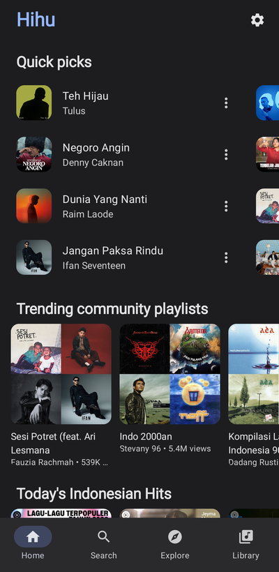
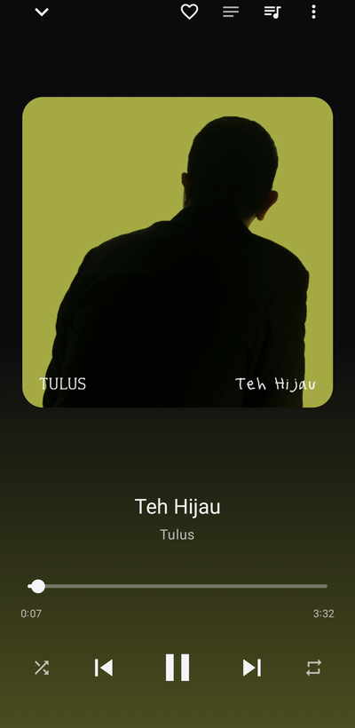
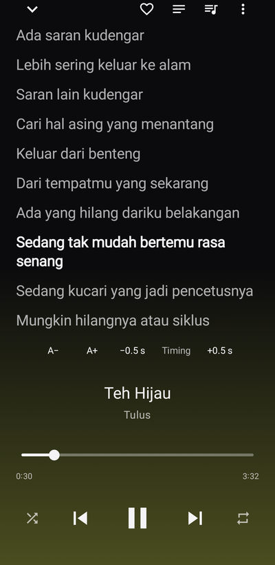
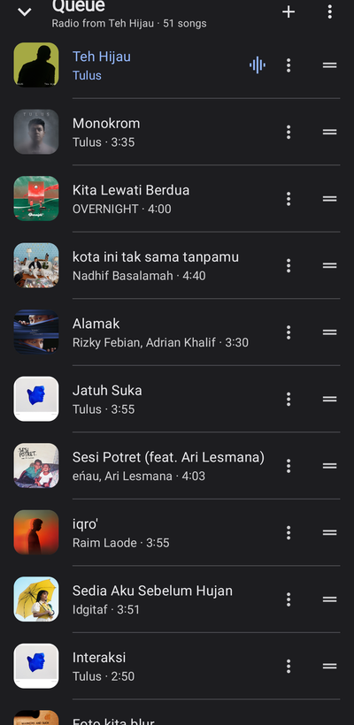
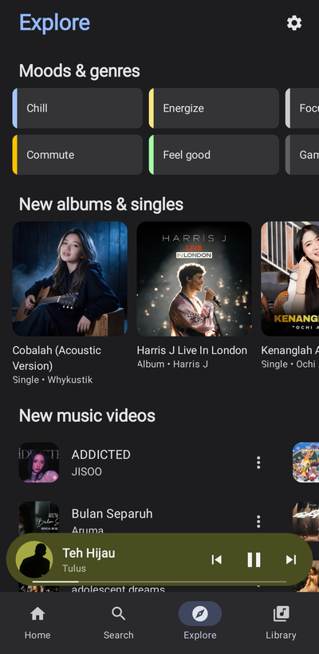

# Hihu

A light music player for Android, for YouTube Music and the music files on your phone.

Built with Kotlin, Jetpack Compose and Media3. Material 3 colours follow your wallpaper.
Decoding is handed to the audio DSP when the phone supports it, so playback with the screen
off costs less battery.

<p>
  
  
  
  
  
</p>

## Status

Early. What works today:

- search YouTube Music for songs, videos, albums or artists, with suggestions as you type and
  more results as you scroll
- open an album or an artist and play or shuffle its songs, or start an artist's radio
- music videos play as audio only, so they cost no more data or battery than a song; in a
  playlist, a radio or the queue a music video plays as its album version, and the player
  switches between the song and the video
- browse the music files on your phone, and play or shuffle all of them
- mini player and full-screen player tinted by the cover, with seek, shuffle and repeat; swipe
  either to change songs, pull the player down to close it, and turn the phone on its side for
  the cover beside the controls
- a stream that drops is tried again by itself, and waits for the network when the phone is
  offline
- favourites, your own playlists, play history, and a queue you can reorder that is still
  there after the app is closed; save the queue as a playlist, or clear what was played or what
  is coming up
- hide a song you don't want to hear: it leaves the queue and stays out of radios and Home
- start a radio from any song, and share a song's YouTube Music link
- sort favourites, downloads and the files on your phone by date added, title or artist, and
  playlists by date, name or size; Hihu warns before adding a song a playlist already has
- hold a song to select several, then queue, add to a playlist, download or hide them at once
- import a public Spotify playlist or album: Hihu finds each song on YouTube Music and lists
  the ones it could not find, or that may be another version (Spotify gives the first 100 songs
  without signing in)
- search within your library: favourites, playlists, downloads, history and the files on
  your phone, with or without accents
- a Home tab with rows made from your own history (keep listening, the albums and playlists
  played lately, on repeat, forgotten
  favourites, similar to the artist you play most, new releases from the artists you play) and YouTube Music's home shelves, no account needed
- an Explore tab like YouTube Music's: moods and genres, new albums and music videos, and
  what is trending in your country, from YouTube Music's charts
- download songs from YouTube Music and play them with no connection, in a quality of their
  own; optionally, every song you heart is downloaded, over Wi-Fi only or on mobile data too.
  Downloads stay inside Hihu and are listed in the library and in settings
- synced lyrics that follow the song, from YouTube Music, timed to the very recording, or else
  from LRCLIB; tap a line to jump to it, move the timing, and make the text larger or smaller
- even out volume (off by default): songs mastered louder than YouTube's usual level are
  turned down
- light or dark theme, and three streaming qualities, set apart for Wi-Fi and mobile data
- fits small windows, like Samsung's pop-up view over a game, by drawing everything smaller
- notification, lockscreen and headset controls; a headset's play button picks up the last
  queue after Hihu was closed, and optionally a paused song carries on when headphones connect

- optionally, sign in to YouTube Music: your account's playlists, albums and artists in the
  library, Home and Explore as your account sees them, and hearts that are also liked on your
  account (likes made elsewhere stay out of Hihu's favourites)

Planned: equalizer.

## Privacy

Hihu has no analytics or crash reporting. Searching and playing talk to YouTube. Signing in
is optional: it happens on Google's own page, and the session stays on the phone, encrypted
with the Android Keystore, and goes only to YouTube Music. YouTube does not allow other apps to
sign in this way, so it could limit the account.
Opening the lyrics of a song asks YouTube Music first. When it has no timed lyrics, and for
the files on your phone, Hihu sends the song's title, artist and length to lrclib.net, and
nothing else. Lyrics are only looked up while they are on screen.
Importing a Spotify playlist opens its public page on open.spotify.com, with no account, and
looks for each song on YouTube Music.

## Install

Download `Hihu-<version>.apk` from the [latest release](../../releases/latest) and open it on
your phone; Android asks once to allow installing apps from your browser or file manager. Each
new release installs over the last one and keeps your favourites, playlists and downloads.

Hihu needs Android 10 or newer.

## Reporting a bug

Open an issue with the **Bug report** template. In Hihu, **Settings → About → Send log** shares
Hihu's own log from this run, with web addresses taken out, to paste into it.

## Build

```sh
./gradlew assembleDebug        # app/build/outputs/apk/debug/app-debug.apk, package app.hihu.debug
./gradlew assembleRelease      # signed only when keystore.properties names a key; see CLAUDE.md
```

The project needs JDK 17 and the Android SDK (`sdk.dir` in `local.properties`, or `ANDROID_HOME`).
Every push to `main` is built by GitHub Actions.

## Credits

The module layout and its rules follow [Sonora](https://github.com/sonorahq/sonora)
(GPL-3.0-or-later), a native desktop music client. Hihu shares no code with it.

YouTube Music search and streams come from
[NewPipeExtractor](https://github.com/TeamNewPipe/NewPipeExtractor) (GPL-3.0-or-later).

Synced lyrics come from YouTube Music and [LRCLIB](https://lrclib.net).

Spotify playlists are read from Spotify's public embed page; Hihu has no Spotify account and is not affiliated with Spotify.

Icons are [Material Icons](https://github.com/google/material-design-icons) (Apache 2.0).

## License

Copyright (C) 2026 Hihu contributors.

Hihu is free software, released under the [GNU General Public License version 3 or
later](LICENSE).

Hihu is an unofficial client. It is not affiliated with, endorsed by, or sponsored by Google
or YouTube.
